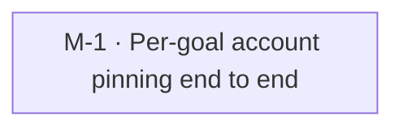

# Per-goal account pinning

Goal `account-pinning` · format `goal/v2`. Live status is derived from GitHub and git and is
never written here: run `goal status --goal account-pinning` or `goal tui --goal account-pinning`.

Let each goal draw only from a configured subset of a platform's accounts (overlapping goals share accounts; goals without an entry use all), carried by a per-goal shunt client token that the goal CLI hands to each session, with the keeper waking on the goal's own subset reset.

## Context, scope and non-goals

<what exists today, what is included, what is explicitly out of scope>

## Risks and open questions

<risks, assumptions, and unknowns; material unknowns become discovery tasks or DEC nodes>

## Plan structure

<!-- goal:graph:start -->

<!-- goal:graph:end -->

## Worker protocol

For an agent executing exactly one task of this goal:

1. Work only on your task, in your own branch and worktree, branched from `origin/main`.
2. Read `tasks/TASK-NNN.md` (the spec), the outcomes of the tasks it depends on, and the
   accepted decisions it depends on. Never edit specs, other tasks, decisions or `goal.yaml`.
3. After your first commit, open a draft PR into `main` whose body contains the line
   `Goal-Task: account-pinning/TASK-NNN`. Write the body with real newlines.
   Use `gh pr create --body-file FILE` or `gh pr edit --body-file FILE`.
   If the repo has several remotes, resolve `origin` with `git remote get-url origin`.
   For a GitHub origin, use `gh pr create --repo <origin OWNER/NAME> --body-file FILE`.
   Pass the same `--repo <origin OWNER/NAME>` to every other `gh pr` command.
4. Do the work and run the spec's Verify commands.
5. Write `tasks/TASK-NNN.outcome.md` with an `## Acceptance` checklist (each item followed by
   its evidence) and a `## Summary` (what, how, deviations, verified revision, proposed
   follow-ups). Commit it in the same PR.
6. Mark the PR ready for review when the spec's Verify commands pass.
   GitHub checks never gate delivery; local Verify decides. Never merge.
   Planning tasks write `proposals/TASK-NNN.yaml`; see goal-setup `references/format.md`, Plan proposals.
7. Waiting only on submitted jobs or detached runs that start or end without owner action?
   Commit and push, keep the PR a draft, add exactly one line
   `Goal-Waiting: until <UTC time>; <job ids and reason>` to its body, and stop through exit (C).
   Use a UTC time such as `2026-10-30T18:00Z`: the latest expected finish, including queue time.
   Name every job id and its queue or host. Start the final message with `WAITING: <reason>`.
   The task stays running. The orchestrator resumes you after that time to inspect the results.
   On resume, continue the task; remove `Goal-Waiting:` before exit (A), or renew it for another wait.
   Blocked by a missing decision, access or data? Explain it in the outcome, add the line
   `Goal-Blocked: <reason>` to the draft PR body, and stop. For a material decision, also
   write `## Decision request` in the outcome with the question, options and trade-offs,
   and your recommendation under `### Recommendation` (omit it if you have none). Add
   `Goal-Decision: <one-line question>` to the draft PR body, commit and push, then stop
   through exit (B). Refresh or `goal sync` creates a decision in the Inbox. Under
   `decide: experts`, the committee gives opinions. A copilot or orchestrator shell records
   the final call with `goal decide`; the ledger names `experts` as the decider.
   The owner can accept or reject any open decision as the human. After acceptance,
   the Resume task action in `:` resumes the task with the decision in its resume note.
8. A task with `repo: NAME` works in that repository's clone, branched from its base (the
   dispatch condition names it). This README and the spec stay here; read them, never copy
   them. Skip the outcome file: put the step 5 `## Acceptance` checklist and `## Summary`,
   and any step 7 explanation or `## Decision request`, in the PR body. `goal merge` saves
   that body as `tasks/TASK-NNN.outcome.md`.
