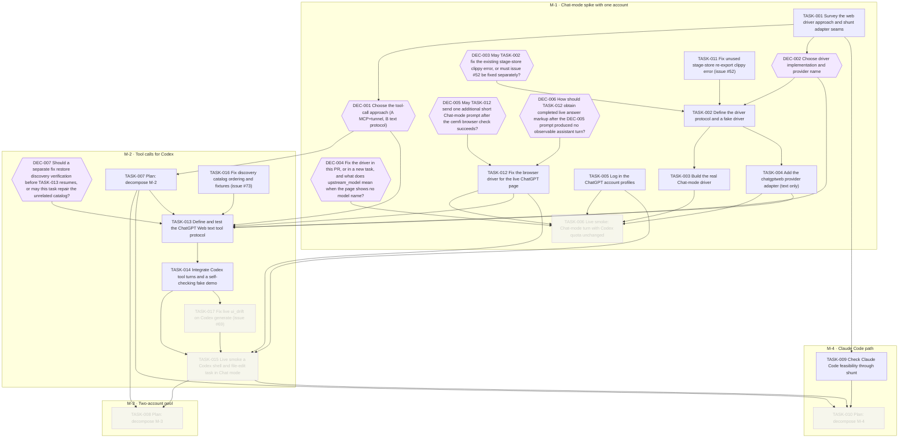

# ChatGPT Web provider for shunt

Goal `chatgptweb-provider` · format `goal/v2`. Live status is derived from GitHub and git and is
never written here: run `goal status chatgptweb-provider` or `goal tui`.

Add a chatgptweb provider to shunt so Codex (and Claude Code if feasible) can use ChatGPT Web models in Chat mode through browser automation, keeping shunt's multi-account rotation.

## Context, scope and non-goals

### Why this goal exists

The owner wants to spend ChatGPT Web usage instead of Codex quota. In ChatGPT Web there are
two modes. **Chat** mode does not consume Codex rate limits. **Work** mode does. So every
part of this goal uses **Chat mode only**, and the driver must check the mode before every
send and fail closed (never fall back to Work mode). This is not a ban on changes: in Chat
mode ChatGPT can still change the owner's repos through its GitHub connector, and that is fine.

An existing skill, `delegate-chatgptweb` (config repo, `shared/skills/delegate-chatgptweb`),
already sends small research questions to ChatGPT Web from Claude Code through GUI
automation. It stays as it is. This goal is about something else: letting **Codex** itself
run on a ChatGPT Web model.

### What we looked at: miuuyy/codex-chatgpt-web

Repo: https://github.com/miuuyy/codex-chatgpt-web (MIT, about 14.9k stars, active, v6.1.x).
It adds ChatGPT Web models ("(Web)") to Codex's model picker.

- An Electron launcher keeps a logged-in ChatGPT browser (up to five task-bound tabs).
- A local daemon on `127.0.0.1` accepts Codex's Responses API turns and replays them in the
  browser, then streams the answer back as Responses events.
- **Browser-only mode:** sends the whole Codex context, no local tools.
- **Full harness mode:** ChatGPT gets a custom MCP connector ("Codex Native2") through
  OpenAI's `tunnel-client` (outbound only). ChatGPT calls tools, and the tool calls run in
  the real Codex task (files, terminal, approvals). Each turn has a random turn token.
- **Zero Risk mode:** the user pastes and sends manually.
- Two accounts can run together only as "normal" plus a separate DEV profile. There is no
  account rotation.
- Docs worth reading: `docs/architecture.md`, `docs/security-model.md`, `TROUBLESHOOTING.md`.

### Why we cannot just install it

Codex here uses `model_provider = "shunt"` (custom provider at `http://127.0.0.1:3001/v1`).
The repo's installer instead keeps the built-in `openai` provider and takes over
`openai_base_url`. Their docs say only one program can own that route. Composition with an
external router (their issue #205) was closed as "not planned". If installed as is, the
(Web) models would not appear (the picker reads shunt's model list) and no turn would reach
the daemon. The owner also refuses to give up shunt's account rotation (two Codex accounts,
`personal` and `cemfi`, in `[providers.codex]`).

Other cons: unofficial browser automation, so UI changes break it; unsigned builds;
a loopback port with no password; prompt-injection risk when tools are on.

### The idea

Build the same concept **inside shunt** as a new provider/adapter (working name
`chatgptweb`). Shunt already has what is needed: per-provider adapters (`src/adapters/`:
anthropic, antigravity, cursor, gemini, responses), account pools with `profile_dir` (used by
antigravity), rotation and failover (`src/proxy/failover.rs`, `src/pool/`), an inbound Codex
Responses endpoint (`[server.codex_endpoint]`), the model catalog it serves to Codex, and
child-process lifecycle handling (`src/shutdown.rs`). Each ChatGPT account becomes one pool
account with its own logged-in browser profile.

Pieces the adapter needs:

1. **Driver:** controls one logged-in ChatGPT tab per account. Checks Chat mode before every
   send. Sends the prompt, reads the streamed answer, detects completion.
2. **Translation:** Responses request in, prompt text out. Web answer in, Responses events out.
3. **Tool calls:** see the two approaches below.
4. **Model list:** list the ChatGPT Web models in shunt's catalog so Codex shows them.

### Tool calls: approach A and approach B (open for discussion in DEC-001)

| | A. Copy the repo: MCP connector and tunnel | B. Text protocol (proposed) |
|---|---|---|
| How | ChatGPT calls tools itself through a custom MCP connector and an OpenAI tunnel. Shunt would run the MCP server and relay each call into Codex's tool surface | Shunt tells ChatGPT to write tool calls in a fixed format. Shunt parses them and returns normal `function_call` items. Codex runs the tool and sends the result next turn |
| Setup per account | Developer Mode, a connector, a tunnel, an API key, each per account | Only a logged-in profile |
| Cost per turn | Low. The whole loop stays in one web answer | Higher. Each turn sends the transcript again to a fresh chat |
| Fit with rotation | Hard. Every account has its own connector and tunnel, and a turn is bound to one | Easy. Every turn is self-contained, so any account can serve it |
| Tool quality | Native web tool use | Depends on the model following the format |
| Extra risk | Tunnel credentials, connector admin policy, a long-lived MCP listener | Malformed or missing tool blocks; need strict parsing |

The proposal is **B first**, and A only if B proves too weak. B keeps shunt simple and keeps
rotation. The final choice is DEC-001 and is for the owner.

### Driver implementation (open: DEC-002)

Option 1: a driver written in Rust inside shunt. Option 2: a small helper process (Node or
Bun) per account behind a stable JSON protocol, started and stopped by shunt like agy.
The owner said "whatever is better long term". The planner's lean is option 2 behind a
stable protocol that shunt owns: the web page changes often, a helper can be fixed and
replaced without rebuilding shunt, and MIT code from the repo can be reused. The cost is a
runtime dependency. DEC-002 decides this after TASK-001's report.

### Owner answers (recorded from the discussion)

1. Ban risk on the pooled accounts: **accepted**. (The same accounts serve Codex. A ban could affect both.)
2. Driver in Rust or helper process: **no preference, choose what is better long term** (DEC-002).
3. Claude Code through shunt: **do it if it is really feasible, otherwise keep it Codex-only** (M-4, gated by a feasibility discovery).

### Scope

Included: the `chatgptweb` provider and adapter in shunt, the driver and its protocol, Chat
mode checks, text-only turns, tool calls for Codex, a two-account pool with rotation and
failover, model catalog entries, docs, and a Claude Code path if feasible.

### Non-goals

- Installing or running the repo's launcher, or changing Codex's `config.toml`
  (`openai_base_url`, `model_provider`).
- Work mode. Any path that could use Codex quota.
- Changing the existing `codex` pool behavior.
- Replacing the `delegate-chatgptweb` skill (it stays for small research questions).
- Note: the `goal` tool already has a worker platform named `chatgptweb`. That one
  dispatches a task to ChatGPT Web that opens a PR through the GitHub connector. It is
  unrelated to this provider. Pick a provider name that avoids confusion (open question).

## Risks and open questions

- **Ban or rate-limit risk** on the pooled accounts (accepted). The driver should be slow and human-like enough to avoid abuse flags (see TASK-001).
- **UI drift:** ChatGPT changes its page. The driver must fail with a clear error, never guess.
- **Context limits:** web models have about 90k tokens (Plus) to 240k (Pro) of context in the repo's measurements. Long Codex tasks compact more often.
- **Speed:** every turn goes through a real page.
- **Chat vs Work detection:** TASK-001 must find a reliable way to read the mode, and TASK-006 must prove that Codex quota does not move.
- **Concurrency:** one tab per account, serialized. Parallel Codex agents will queue.
- **Provider name** collides with the goal tool's `chatgptweb` worker platform. Decide in TASK-001/DEC-002.
- **Claude Code path** needs tool calls in Anthropic format. Feasibility is checked in M-4, after the Codex tool path exists.
- **Outside blockers:** the owner must log in to both ChatGPT accounts in the driver profiles (TASK-005).

## Plan structure

<!-- goal:graph:start -->

<!-- goal:graph:end -->

## Worker protocol

For an agent executing exactly one task of this goal:

1. Work only on your task, in your own branch and worktree, branched from `origin/main`.
2. Read `tasks/TASK-NNN.md` (the spec), the outcomes of the tasks it depends on, and the
   accepted decisions it depends on. Never edit specs, other tasks, decisions or `goal.yaml`.
3. After your first commit, open a draft PR into `main` whose body contains the line
   `Goal-Task: chatgptweb-provider/TASK-NNN`. Write the body with real newlines.
   Use `gh pr create --body-file FILE` or `gh pr edit --body-file FILE`.
   If the repo has several remotes, resolve `origin` with `git remote get-url origin`.
   For a GitHub origin, use `gh pr create --repo <origin OWNER/NAME> --body-file FILE`.
   Pass the same `--repo <origin OWNER/NAME>` to every other `gh pr` command.
4. Do the work and run the spec's Verify commands.
5. Write `tasks/TASK-NNN.outcome.md` with an `## Acceptance` checklist (each item followed by
   its evidence) and a `## Summary` (what, how, deviations, verified revision, proposed
   follow-ups). Commit it in the same PR.
6. Mark the PR ready for review when the spec's Verify commands pass.
   GitHub checks never gate delivery; local Verify decides. Never merge.
   Planning tasks write `proposals/TASK-NNN.yaml`; see goal-setup `references/format.md`, Plan proposals.
7. Blocked by a missing decision, access or data? Explain it in the outcome, add the line
   `Goal-Blocked: <reason>` to the draft PR body, and stop. For a material decision, also
   write `## Decision request` in the outcome with the question, options and trade-offs,
   and your recommendation under `### Recommendation` (omit it if you have none). Add
   `Goal-Decision: <one-line question>` to the draft PR body, commit and push, then stop
   through exit (B). Refresh or `goal sync` creates a decision in the Inbox. Under
   `decide: experts`, the committee gives opinions. A copilot or orchestrator shell records
   the final call with `goal decide`; the ledger names `experts` as the decider.
   The owner can accept or reject any open decision as the human. After acceptance,
   the Resume task action in `:` resumes the task with the decision in its resume note.
