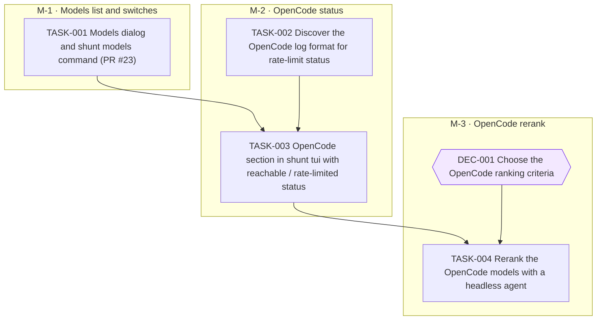

# Model on/off list in shunt tui

Goal `model-filter` · format `goal/v2`. Live status is derived from GitHub and git and is
never written here: run `goal status model-filter` or `goal tui`.

Let the operator switch codex, opencode and agy models on or off in shunt tui, feed only the active models to the goal tool and /delegate-cli, and show OpenCode free-model status and an on-demand ranking.

## Context, scope and non-goals

Model names are hard-coded in the goal tool, the `delegate-cli` skill and the global rules, and they go
stale. This goal makes `shunt tui` the one place that lists the models of the three CLI platforms
(`codex`, `opencode`, `agy`) live, and lets the operator switch each model on or off. The owner approved the design in a planning session.

**Included (this goal, shunt repo):** the Models dialog and `shunt models` (PR #23, in review), an OpenCode
section with reachable / rate-limited status, and an on-demand rerank of the OpenCode models.

**Other repo:** the goal tool and the `delegate-cli` skill live in the config repo. Their side is the goal
`model-filter-consumer` in that repo. It needs `shunt models --json` from TASK-001 here.

**Decisions already made by the owner:**
- A global filter switch lives in the Models dialog. Default: on.
- Off means hidden **and** blocked in the goal tool.
- The switches affect only the goal tool and `/delegate-cli`. Gateway routing, `/v1/models` and Claude Code's `/model` picker do not change.
- The goal tool fails open (shows all models) when shunt is missing or fails.
- The rerank agent defaults to `claude -p` with web search. The owner can set any platform.

**Non-goals:** automatic daily ranking; any change to gateway routing; the Claude platform (its aliases
already track the latest); changing `deny_models` in `goal.yaml`.

## Risks and open questions

- **OpenCode has no quota API.** The free tier answers 403 to any non-opencode client, so status is read
  passively from `~/.local/share/opencode/log/opencode.log`. The log format for successes is not known yet,
  so TASK-002 is a discovery task before the section is built.
- **The rank criteria are not chosen.** DEC-001 holds that choice. The rerank task waits for it.
- **Rolling wave:** the plan details all three milestones because the owner approved the full design.
  Later work can still add `Plan: decompose M-n` tasks if a spike changes the shape.
- **Needs a live `opencode` and `claude` on `PATH`** for the live runs. The launchd daemon has a minimal `PATH`,
  so all of this runs in the TUI or CLI process, never in the daemon.
- **`chatgptweb` as ranker:** the owner wants any platform to be usable as the ranker, but `chatgptweb` needs a
  browser session that shunt cannot start. TASK-004 reports it as unsupported. Say so if you want another route.
- **Docs:** each PR that changes shunt behaviour updates README (+ko/ja/zh-CN), `docs/` and the site pages
  with their ko/ja/zh-cn copies, per `AGENTS.md`.

## Plan structure

<!-- goal:graph:start -->

<!-- goal:graph:end -->

## Worker protocol

For an agent executing exactly one task of this goal:

1. Work only on your task, in your own branch and worktree, branched from `origin/main`.
2. Read `tasks/TASK-NNN.md` (the spec), the outcomes of the tasks it depends on, and the
   accepted decisions it depends on. Never edit specs, other tasks, decisions or `goal.yaml`.
3. After your first commit, open a draft PR into `main` whose body contains the line
   `Goal-Task: model-filter/TASK-NNN`. Write the body with real newlines.
   Use `gh pr create --body-file FILE` or `gh pr edit --body-file FILE`.
   If the repo has several remotes, resolve `origin` with `git remote get-url origin`.
   For a GitHub origin, use `gh pr create --repo <origin OWNER/NAME> --body-file FILE`.
   Pass the same `--repo <origin OWNER/NAME>` to every other `gh pr` command.
4. Do the work and run the spec's Verify commands.
5. Write `tasks/TASK-NNN.outcome.md` with an `## Acceptance` checklist (each item followed by
   its evidence) and a `## Summary` (what, how, deviations, verified revision, proposed
   follow-ups). Commit it in the same PR.
6. Mark the PR ready for review when checks pass or none are configured.
   Failing or pending checks block delivery unless repository or owner rules explicitly
   override that requirement. Follow those rules for allowed evidence sources. Never merge.
7. Blocked by a missing decision, access or data? Explain it in the outcome, add the line
   `Goal-Blocked: <reason>` to the draft PR body, and stop. For a material decision, also
   write `## Decision request` in the outcome with the question, options and trade-offs,
   and your recommendation under `### Recommendation` (omit it if you have none). Add
   `Goal-Decision: <one-line question>` to the draft PR body, commit and push, then stop
   through exit (B). Refresh or `goal sync` creates a decision in the Inbox. Under
   `decide: experts`, the committee gives opinions. A copilot or orchestrator shell records
   the final call with `goal decide`; the ledger names `experts` as the decider.
   The owner can accept or reject any open decision as the human. After acceptance,
   the Resume task action in `:` resumes the task with the decision in its resume note.
